<p align="center">
  <picture>
    <source media="(prefers-color-scheme: dark)" srcset="docs/img/banner-escuro.png">
    
  </picture>
</p>

<h1 align="center">Tou, Câmara?</h1>

<p align="center">
  <strong>A câmara inteira, numa só plataforma. Uma porta para o munícipe, um sistema para a câmara.</strong><br>
  O munícipe liga, escreve ou manda um SMS a qualquer hora e trata do assunto na conversa, com respostas das fontes oficiais.<br>
  Quando há alguma coisa a fazer, é a câmara que liga primeiro. Por trás, a câmara recebe tudo no mesmo sistema.
</p>

<p align="center">
  <a href="https://toucamara.descortina.pt"></a>
  
  
  
  
  <br>
  
  
  
  
  
  
  
  
  
</p>

<p align="center">
  <a href="https://toucamara.descortina.pt"><strong>Experimentar</strong></a> ·
  <a href="https://toucamara.descortina.pt/ligar"><strong>Ligar no browser</strong></a> ·
  <a href="https://toucamara.descortina.pt/ligar?experimentar=renovacao"><strong>Renovar uma licença com o seu telemóvel</strong></a> ·
  <a href="https://toucamara.descortina.pt/funcionalidades"><strong>As 90 funcionalidades</strong></a> ·
  <a href="#arrancar"><strong>Arrancar</strong></a>
</p>

<p align="center"><em>Guilherme Ferreira e David Vieira · Hack4Guimarães 2035 · Desafio «Falar com a câmara sem burocracia»</em></p>

---

| **24 h** | **48** | **61 de 90** | **180** | **0** |
| :---: | :---: | :---: | :---: | :---: |
| por dia, também com o balcão fechado | ações que o assistente faz durante a chamada: pedidos, licenças, ocorrências, marcações, pagamentos | funcionalidades a funcionar de ponta a ponta; as outras 29 estão marcadas no ecrã (demonstração, modo de teste ou só na API) | perguntas de teste, cada uma com a resposta certa escrita das fontes oficiais e revista por uma pessoa | erros automáticos de acessibilidade em 42 páginas (WCAG 2.1 AA) |

<p align="center">
  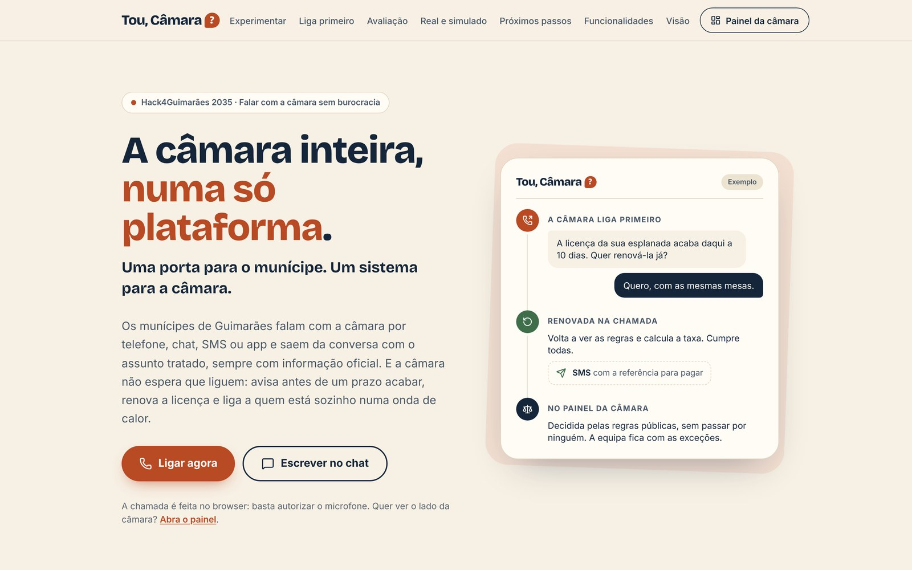
</p>

**Nesta página:** [Porque é difícil](#porque-é-difícil-falar-com-a-câmara) · [A chamada é só a parte que se ouve](#a-chamada-é-só-a-parte-que-se-ouve) · [Como se vê](#como-se-vê) · [O que faz](#o-que-faz) · [Só responde com fonte](#só-responde-com-fonte) · [Real e simulado](#o-que-é-real-e-o-que-é-simulado) · [Como está feito](#como-está-feito) · [Tecnologias](#tecnologias) · [Arrancar em local](#arrancar-em-local) · [Como sabemos que funciona](#como-sabemos-que-funciona) · [O repositório](#o-repositório) · [No ar](#no-ar) · [Dados pessoais](#dados-pessoais-e-segurança) · [Próximos passos](#próximos-passos) · [Mais documentos](#mais-documentos)

## Porque é difícil falar com a câmara

Saber que licença é precisa, que documentos entregar e em que ponto está um processo obriga hoje a ir ao balcão, mandar um email ou telefonar, e só no horário de atendimento.
A informação existe, mas está espalhada: Guimarães tem mais de 20 sites de entidades municipais e associadas (rodapé de [cm-guimaraes.pt](https://www.cm-guimaraes.pt)).

> **O que o desafio pede** (sessão de esclarecimentos da organização): alguém faz uma pergunta real sobre um serviço municipal e recebe uma resposta correta, em linguagem simples, de forma rápida.

Mas a resposta é só o princípio. Depois vem o requerimento, os documentos que faltam, o prazo que passa sem aviso, a licença que caduca, o buraco que três pessoas reportam três vezes. **A relação com a câmara não começa quando a pessoa liga, nem acaba quando desliga.**

## A chamada é só a parte que se ouve

**Uma porta para o munícipe.** Liga, escreve no chat ou manda um SMS, a qualquer hora. O assistente responde com a fonte oficial (o documento, o artigo e a data), preenche o requerimento durante a conversa, regista a ocorrência com a morada, marca o atendimento, diz em que ponto está o processo e manda a referência para pagar. Quando é preciso uma pessoa, passa a um funcionário com o caso resumido. Numa emergência, o 112.

**Liga primeiro.** A câmara não espera que a pessoa ligue: avisa antes de uma licença acabar e renova-a na própria chamada, liga antes de um prazo prejudicar a pessoa, liga a quem vive sozinho numa onda de calor e a quem pode ter direito a um apoio e ainda não o pediu.

**Um sistema para a câmara.** Telefone, chat, email e balcão chegam à mesma entrada, com cada pedido no serviço e no técnico certos. O que cumpre regras públicas decide-se sozinho, com o porquê; o resto chega ao técnico já analisado, com o regulamento aplicável e o rascunho do ofício. A chefia vê onde param os processos e pergunta pelos números em linguagem normal.

**O que propomos:** um piloto em Guimarães para medir a taxa de acerto com chamadas reais, os técnicos validarem as regras dos projetos de obras e ligar os sistemas que a câmara já tem.

## Como se vê

<table>
  <tr>
    <td width="50%">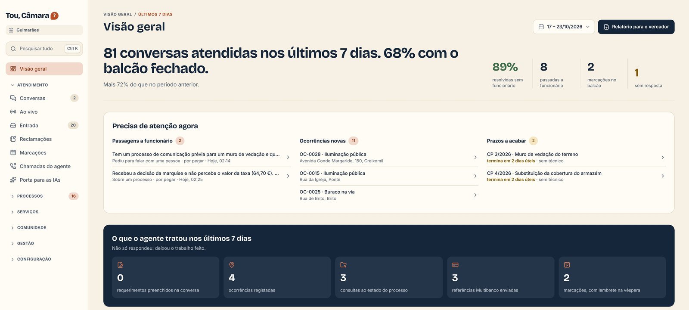<br><sub><b>Visão geral.</b> A semana num relance: o que o assistente deixou feito e o que precisa de atenção agora.</sub></td>
    <td width="50%">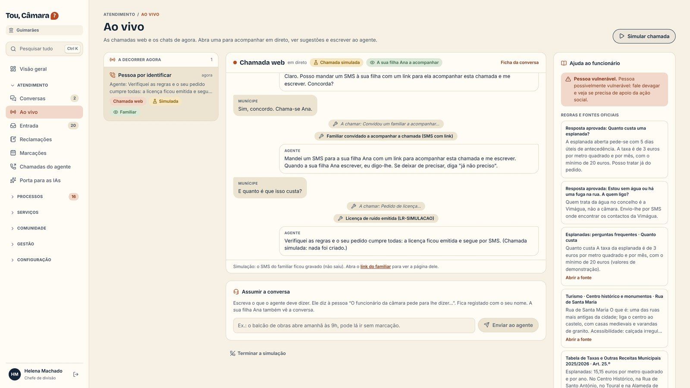<br><sub><b>Ao vivo.</b> A chamada em direto, com as ações do assistente, as fontes ao lado e o botão para o funcionário assumir.</sub></td>
  </tr>
  <tr>
    <td>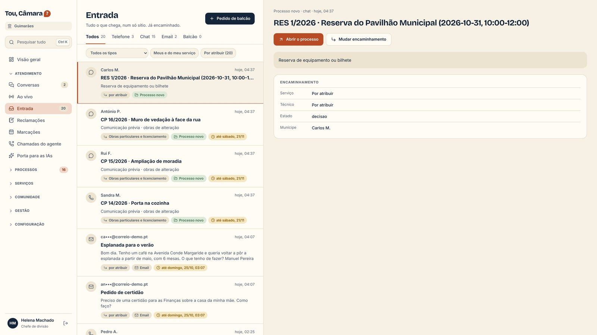<br><sub><b>Entrada única.</b> Telefone, chat, email e balcão na mesma lista, cada pedido no serviço certo.</sub></td>
    <td>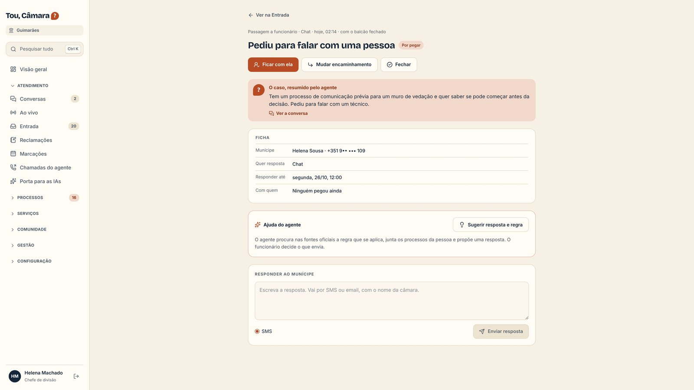<br><sub><b>Passagem a funcionário.</b> Quando não sabe, não inventa: o caso chega resumido.</sub></td>
  </tr>
  <tr>
    <td>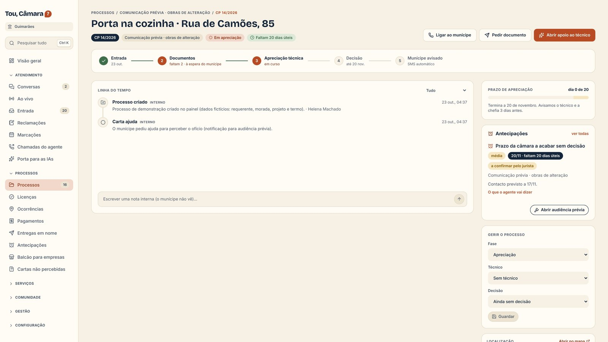<br><sub><b>Processo.</b> As fases, a linha do tempo e o prazo em dias úteis, com o aviso antes de acabar.</sub></td>
    <td>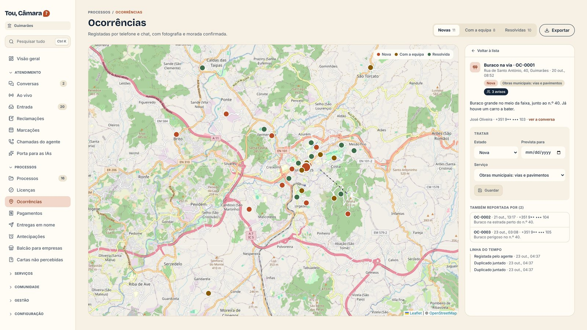<br><sub><b>Ocorrências.</b> No mapa do concelho; o mesmo buraco reportado três vezes é uma só ocorrência.</sub></td>
  </tr>
  <tr>
    <td>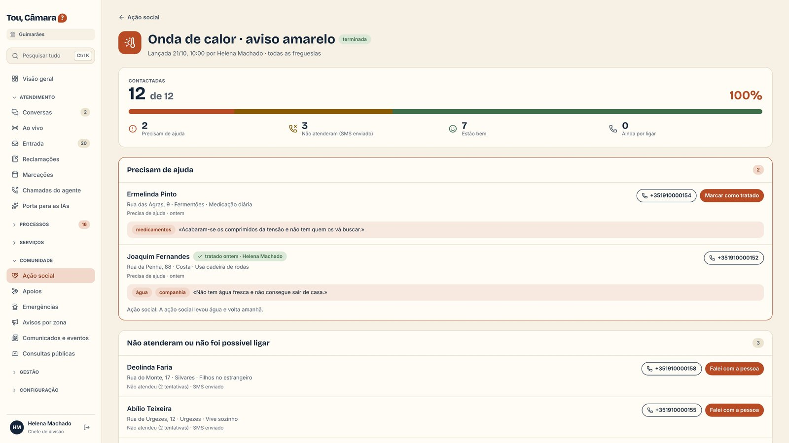<br><sub><b>Liga primeiro.</b> Numa onda de calor, o assistente liga a quem se inscreveu; quem precisa de ajuda aparece primeiro.</sub></td>
    <td>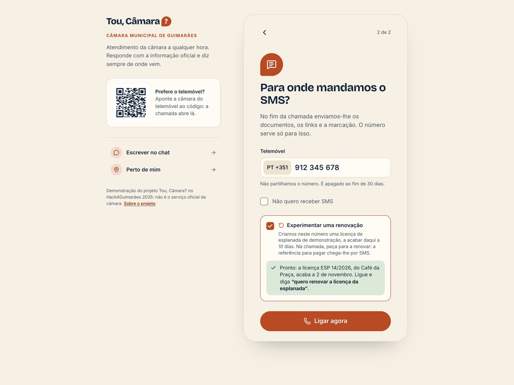<br><sub><b>Ligar no browser.</b> Sem instalar nada; a renovação de uma licença do princípio ao fim, com o número de quem experimenta.</sub></td>
  </tr>
</table>

As pessoas, conversas e processos do painel são **dados de demonstração**, fictícios e com telefones da gama de teste, que nunca recebem SMS nem chamadas.

<p align="center">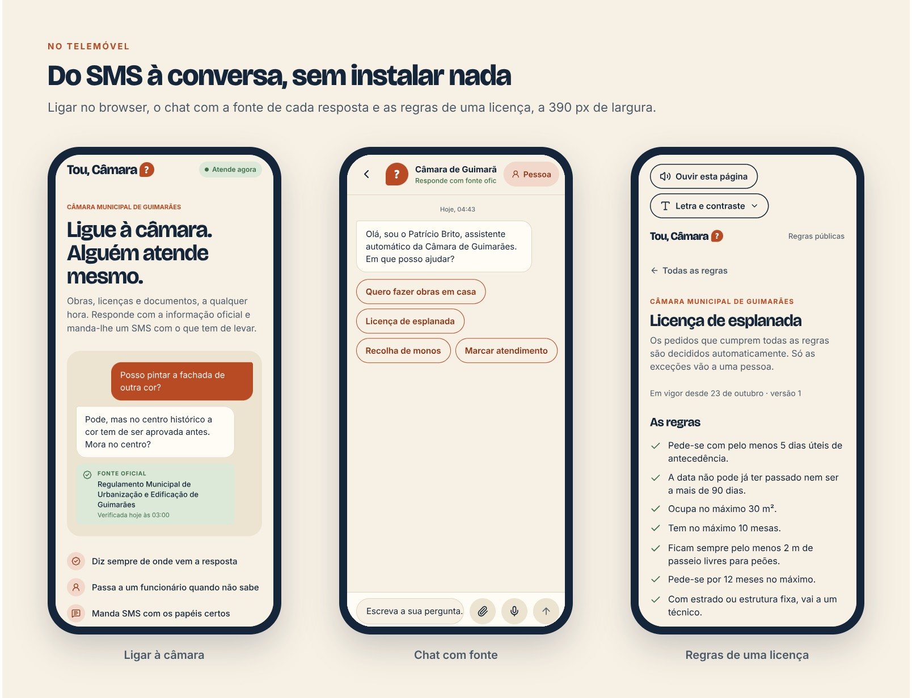</p>

O munícipe chega quase sempre pelo telemóvel, a partir do link do SMS. As páginas públicas estão pensadas para o ecrã pequeno e têm, no topo, «Ouvir esta página» e «Letra e contraste».

## O que faz

| O quê | Onde | Como |
| --- | --- | --- |
| **Chamada por voz** | `/ligar` | No browser, sem instalar nada. 48 ações durante a chamada; aviso de gravação no início; resumo por SMS no fim |
| **Chat** | `/chat` | O mesmo assistente, por escrito, com a fonte de cada resposta |
| **SMS** | por mensagem | O resumo no fim da conversa, o estado do processo e as respostas por SMS |
| **Requerimentos** | na conversa | Preenchidos durante a conversa; os documentos verificados por foto antes de entregar |
| **Licenças simples** | na conversa, `/licenca` | Decididas na chamada por regras públicas, com PDF e QR; o que sai das regras vai para o técnico |
| **Ocorrências** | na conversa, `/ocorrencia` | Com foto e morada, no mapa; os avisos repetidos juntam-se ao original |
| **O concelho numa só porta** | na conversa | A câmara, as juntas, as empresas municipais e os serviços nacionais |
| **Liga primeiro** | `/painel/antecipacoes`, `/painel/campanhas` | Licenças a acabar, prazos, processos que avançam, ondas de calor, apoios por pedir |
| **Entrada única** | `/painel/entrada` | Telefone, chat, email e balcão, com o serviço, o técnico e o prazo |
| **Conversas e ao vivo** | `/painel/conversas`, `/painel/ao-vivo` | Transcrição, momentos, fontes citadas; o funcionário assume quando quiser |
| **Processos e apoio ao técnico** | `/painel/processos` | Linha do tempo, documentos, prazos em dias úteis, verificação do projeto e rascunho do ofício |
| **Regras públicas** | `/painel/licencas`, `/painel/ordenamento` | Licenças e zonas do PDM decididas em código; uma regra nova testa-se contra os pedidos antigos antes de ser aprovada |
| **Chefia** | `/painel`, `/painel/indicadores`, `/painel/relatorios` | Onde param os processos, perguntas em linguagem normal, resumo diário e relatório para o vereador |
| **Conhecimento** | `/painel/conhecimento` | Fontes oficiais lidas todos os dias, com a data; alterações e contradições por rever |
| **Juntas de freguesia** | `/junta` | Painel próprio, mais simples |
| **Avaliação aberta** | `/avaliacao` | As perguntas de teste, a resposta certa e o veredicto, pergunta a pergunta |
| **Porta para as IAs** | `/ia` | A porta oficial da câmara para os assistentes de IA das pessoas (MCP) |
| **Apps** | `code/mobile` | App do munícipe (entrada por código SMS) e app da equipa de campo (funciona sem rede) |

A lista completa, com o estado de cada uma, está em [/funcionalidades](https://toucamara.descortina.pt/funcionalidades).

## Só responde com fonte

O assistente procura nas fontes oficiais antes de responder e **não inventa**: sem fonte, passa a um funcionário. As decisões com regras públicas são do código, não do modelo.

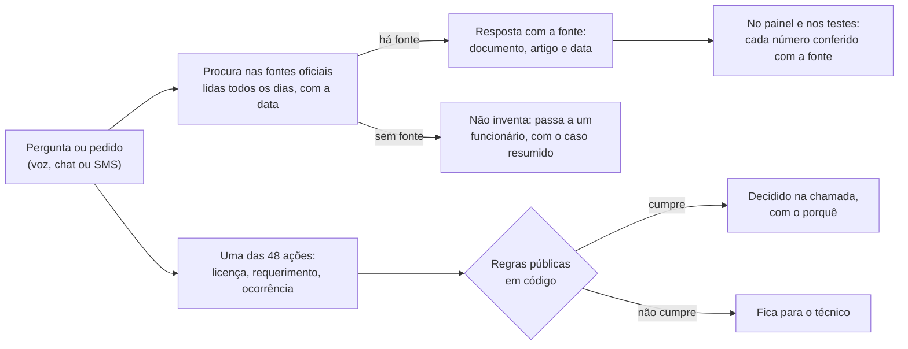

- **O assistente trata de:** perceber o pedido, procurar e explicar em linguagem simples, preencher o requerimento na conversa, resumir o caso para o funcionário, ler documentos e projetos e escrever o rascunho do ofício.
- **O assistente não decide:** licenças e zonas do PDM decidem-se por regras públicas no código, com o porquê; sem fonte, não há resposta; e os dados pessoais de que não precisa nem lhe chegam.
- **Dados pessoais tirados antes da IA** (`code/api/src/ia/minimizar.ts`): emails, IBAN, cartões, telefones e NIF passam a uma etiqueta onde não fazem falta.
- **Texto de fora é dado, nunca instrução** (`code/api/src/ia/nao-confiavel.ts`): páginas, emails, cartas e o que o munícipe diz entram delimitados, com um marcador que o texto não consegue adivinhar.
- **Números na fonte** (`code/api/src/modules/conhecimento/numeros-na-fonte.ts`): cada valor de uma resposta é procurado nos trechos citados; os que não estão aparecem marcados no painel e contam nos testes.
- **Avaliador** (`code/avaliador`): 180 perguntas de teste, cada uma com a resposta certa escrita a partir das fontes oficiais e revista por uma pessoa. Dois juízes automáticos, às cegas, comparam e explicam cada veredicto; onde discordam, decide um terceiro que verifica nas fontes. Na avaliação de 22 e 23 de outubro, **em 82 das 180 perguntas o munícipe sai a saber o que fazer**, e em mais 64 fica ajudado; quando responde, 74% das respostas estão certas ou quase, e nas outras 34 diz que não encontrou em vez de inventar. As mesmas perguntas, feitas ao assistente que a câmara já tem no site: 15 em 180. Resultados abertos em [/avaliacao](https://toucamara.descortina.pt/avaliacao).
- **Custos:** o custo de cada atendimento aparece no painel, com um limite mensal.

## O que é real e o que é simulado

| | |
| --- | --- |
| **Funciona de ponta a ponta** | Chamada por voz no browser, chat, respostas com fonte, passagem a funcionário, requerimentos, ocorrências, estado do processo, renovação de licenças, marcações, as chamadas e os SMS da câmara, painel e relatórios |
| **Em modo de teste** (e marcado nos ecrãs) | Pagamentos, Chave Móvel Digital e entrega do pedido em nome da pessoa, ligação à empresa da água, alertas de emergência pelos operadores |
| **Dados de demonstração** | Pessoas e conversas do painel, escolas, habitação, estacionamento, reservas, cemitérios, animais, turismo, juntas, apoios, os valores das licenças e as zonas do PDM |
| **Ainda não** | Número de telefone português: a demonstração é por chamada no browser |

## Como está feito

<p align="center">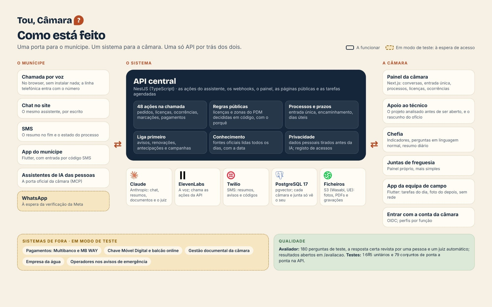</p>

Uma só API (`code/api`) serve o assistente de voz, o chat, o SMS, o painel, as páginas públicas e as tarefas agendadas. A voz é do ElevenLabs, que chama as ações da API (`code/api/agente-voz/` gera os agentes a partir do código). A inteligência artificial é o Claude, da Anthropic. Os SMS saem pelo Twilio. Cada câmara e cada junta só vê os seus dados, por segurança ao nível da linha na base de dados.

## Tecnologias

| Parte | Com quê |
| --- | --- |
| API | NestJS 11 (TypeScript), SQL à mão sobre `pg`, zod, pg-boss para as tarefas agendadas |
| Base de dados | PostgreSQL 17 com pgvector (pesquisa por texto e por vetores, juntas por RRF), segurança por linha |
| Web | Next.js 16, React 19, Tailwind 4 |
| Apps | Flutter (munícipe e equipa de campo) |
| Voz | ElevenLabs (agentes de entrada e de saída gerados do código) |
| IA | Claude (Anthropic), hoje pela API da Anthropic; para uma câmara, no Amazon Bedrock com processamento na UE |
| SMS | Twilio |
| Ficheiros | S3 compatível, na UE |
| Mapas | Mapbox (3D) com Leaflet e OpenStreetMap como alternativa |
| Avaliador | TypeScript (bun) |
| Deploy | Docker, Caddy com HTTPS |

## Arrancar em local

```bash
docker compose -f env/dev/docker-compose.yml up -d    # Postgres 17 + pgvector na porta 54330

cd code/api && cp .env.example .env && bun install && bun run start:dev   # migrações no arranque
cd code/web && cp .env.example .env.local && bun install && bun run dev
```

Sem chaves de IA, de voz ou de SMS a API arranca na mesma; os SMS para os telefones de teste ficam gravados e não saem. Cada pasta tem o seu README com os pormenores (testes, variáveis, agente de voz, apps).

## Como sabemos que funciona

| Parte | Testes |
| --- | --- |
| API | **1 685 testes unitários** (Jest) em 146 ficheiros, a passar |
| Ponta a ponta | **79 conjuntos** de testes da API contra um PostgreSQL real (`npm run test:e2e`), incluindo a preparação da demonstração, que tem de dar os mesmos números quando corre duas vezes |
| Assistente | O avaliador: 180 perguntas, resposta certa revista por uma pessoa, dois juízes às cegas e um terceiro a desempatar; 82 das 180 saem a saber o que fazer. Resultados em [/avaliacao](https://toucamara.descortina.pt/avaliacao) |
| Acessibilidade | Playwright com axe-core: 0 erros automáticos em 42 páginas, WCAG 2.1 AA ([`docs/ACESSIBILIDADE.md`](docs/ACESSIBILIDADE.md), com o que ainda falta) |
| Web | TypeScript estrito e ESLint |

## O repositório

```
code/api/        API central (NestJS): ações do assistente, webhooks, chat, painel, páginas públicas, tarefas
code/web/        Painel da câmara, chat, chamada no browser (/ligar) e as páginas dos links do SMS (Next.js)
code/mobile/     App do munícipe e app da equipa de campo (Flutter)
code/avaliador/  As perguntas de teste, a resposta certa e o juiz
env/             Docker para desenvolvimento e testes
docs/            Acessibilidade, mapas, credenciais externas e as regras dos projetos para os técnicos validarem
```

## No ar

Em produção em **[toucamara.descortina.pt](https://toucamara.descortina.pt)**, com Docker numa VPS e o Caddy a dar o HTTPS. A API corre as migrações no arranque. A demonstração prepara-se a partir do painel, de forma idempotente: correr duas vezes não duplica nada, e numa câmara com fontes próprias não mexe nas fontes, nas respostas nem nas avaliações.

## Dados pessoais e segurança

- **Aviso de gravação** no início de cada chamada, com a opção de não gravar.
- **NIF cifrado** na base de dados; **registo de acessos** a dados pessoais; dados **apagados no fim do prazo** de retenção.
- **Cada câmara e cada junta só vê os seus dados**, por segurança ao nível da linha no PostgreSQL.
- **Dados pessoais tirados antes da IA** onde não fazem falta, e texto de fora tratado como dado, nunca como instrução.
- **IA na UE:** para uma câmara, o Claude passa para o Amazon Bedrock, com processamento na UE (hoje é pela API da Anthropic).
- **Ação social com consentimento:** só se liga a quem se inscreveu, com a data e a origem do consentimento.
- **Telefones de teste** (+351 910 000 xxx): nunca recebem SMS nem chamadas; é com eles que a demonstração funciona.

## Próximos passos

Quase tudo o que falta é acesso, não código: o fluxo já existe e está à espera de uma credencial ou de um acordo.

| O que falta | Já existe | Para fechar |
| --- | --- | --- |
| Sem número de telefone português | Assistente de voz, início e fim da chamada, chamadas feitas pela câmara | Comprar o número e ligá-lo ao assistente |
| Taxa de acerto medida só com perguntas de teste | Avaliador com 180 perguntas e juiz | Medir com chamadas reais no piloto |
| Regras dos projetos de obras escritas por nós | As regras, com o artigo de cada uma ([`docs/VALIDAR_REGRAS_PROJETOS.md`](docs/VALIDAR_REGRAS_PROJETOS.md)) | Os técnicos da câmara validarem |
| Sistemas da câmara simulados | Ligações à gestão documental, aos pagamentos e à empresa da água, em modo de teste | Saber que sistemas a câmara usa e ter acesso; contrato com um fornecedor de pagamentos |
| Chave Móvel Digital simulada | Entregar o pedido em nome da pessoa, de ponta a ponta | Credenciação na AMA e acesso ao balcão online |
| WhatsApp à espera da Meta | Canal completo, com o mesmo assistente | Verificação da conta |
| Apps fora das lojas | App do munícipe e app da equipa de campo | Google Play; no iPhone, a aprovação da Apple |
| IA ainda pela API da Anthropic | O Claude, com dados pessoais minimizados | Amazon Bedrock, com processamento na UE |
| Acessibilidade por acabar | 0 erros automáticos em 42 páginas | Vídeos em Língua Gestual Portuguesa e scroll lateral de algumas páginas do painel a 320 px |

## Mais documentos

- [`docs/ACESSIBILIDADE.md`](docs/ACESSIBILIDADE.md): o que foi testado e o que ainda falta.
- [`docs/MAPAS.md`](docs/MAPAS.md): o Mapbox e a alternativa sem token.
- [`docs/CREDENCIAIS_EXTERNAS.md`](docs/CREDENCIAIS_EXTERNAS.md): o que é preciso para cada ligação a sistemas de fora.
- [`docs/VALIDAR_REGRAS_PROJETOS.md`](docs/VALIDAR_REGRAS_PROJETOS.md): as regras dos projetos de obras, para os técnicos validarem.
- O README de cada pasta em `code/`, com os pormenores de cada parte.

## Equipa

Guilherme Ferreira e David Vieira, desenvolvimento técnico.

Letras Bricolage Grotesque e Inter (SIL Open Font License); mapas do Mapbox e do OpenStreetMap. As pessoas da demonstração são inventadas. O código está aberto para consulta, sem licença de utilização.
